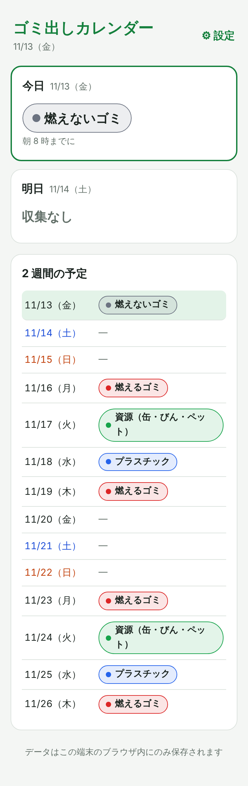
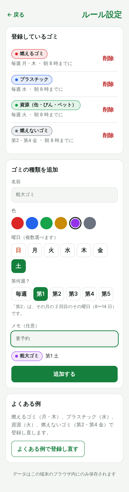
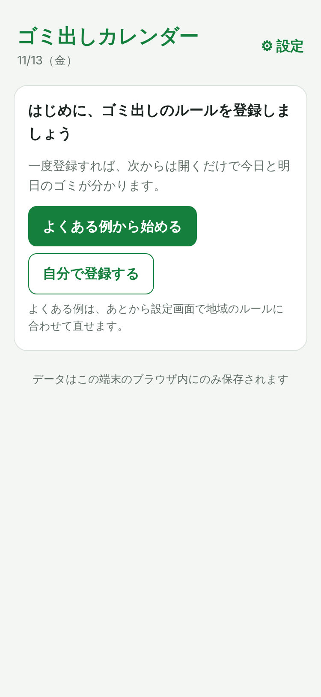
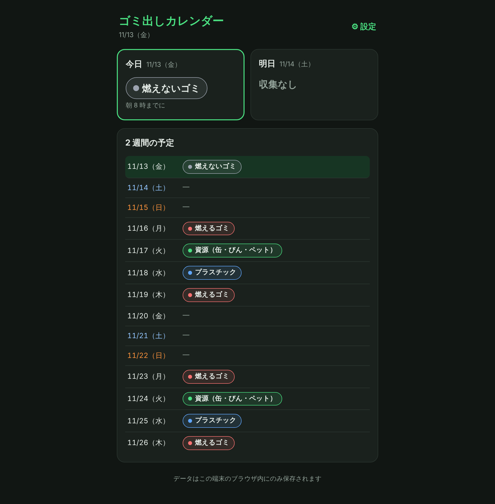

# ゴミ出しカレンダー 🗑️

地域のゴミ出しルール（曜日・第何週）を一度登録すれば、**開くだけで今日・明日に何を出すかが分かる** Web アプリです。
ログイン不要。データはブラウザの中だけに保存されます。

- 公開 URL: 【公開後に追記】
- 記事: 【公開後に追記】

| 今日・明日・2 週間 | ルール設定 | はじめての画面 |
|---|---|---|
|  |  |  |

<details>
<summary>PC・ダークモード表示</summary>


</details>

## 誰のため？
引っ越したばかりで地域のゴミ出しルールを覚えていない **一人暮らしの社会人**。
自治体の分別表は情報が多くて毎朝見るには不向きで、「第 2・第 4 金曜」のようなルールは数え間違えて出し忘れがちです。

## 主な機能
- **今日・明日のゴミ**を色付きで大きく表示（ない日は「収集なし」）
- **2 週間の予定**一覧（土日は色分け、今日の行を強調）
- ゴミの種類の登録：名前・色・曜日（複数）・**第何週**（毎週 / 第 1〜5 を複数）・メモ
- **よくある例から始める**（燃えるゴミ・プラスチック・資源・燃えないゴミ）
- ブラウザへの自動保存、スマホ対応、ダークモード

## 技術スタック
| 分類 | 使用技術 |
|------|----------|
| フロントエンド | React 19 / TypeScript / Vite |
| 画面の切り替え | URL ハッシュ（`#settings`） |
| データ保存 | localStorage（サーバー・DB なし） |
| テスト | Vitest（曜日・第何週の判定など） |
| Lint | oxlint |
| 動作確認・スクショ | Playwright（時計を固定して日付ごとの表示を確認） |
| ホスティング | Vercel |
| 開発 | Claude Code（`/init`・CLAUDE.md・Plan Mode） |

## 「第何週」の判定
「第 2 金曜」は **その月の 2 回目の金曜日**（8〜14 日の金曜）として判定します。カレンダーの行ではありません。
計算は `Math.ceil(日付 / 7)` で、`src/lib/schedule.ts` の純粋関数とテストで確認しています。

## 開発
```bash
npm install
npm run dev      # 開発サーバー
npm test         # 単体テスト
npm run lint     # Lint
npm run build    # 型チェック + 本番ビルド
```

## ドキュメント
| ファイル | 内容 |
|---|---|
| [docs/requirements.md](docs/requirements.md) | 要件定義書（T-06） |
| [docs/user-story-map.md](docs/user-story-map.md) | ユーザーストーリーマップ（T-04）＋[図](docs/user-story-map.png) |
| [docs/information-architecture.md](docs/information-architecture.md) | サイトマップ・ページ一覧（T-05） |
| [docs/plan.md](docs/plan.md) | Plan Mode で承認した設計 |
| [CLAUDE.md](CLAUDE.md) | Claude Code 用のプロジェクトルール |

## ライセンス
MIT
