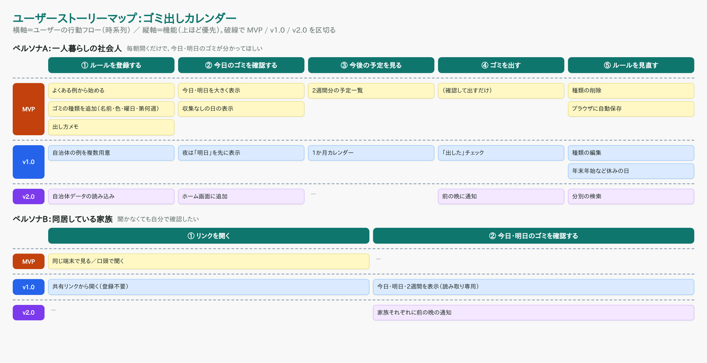

# 【Claude Code】「今日は何ゴミ？」に開くだけで答えるゴミ出しカレンダーを作った（2 作目）

## 作ったもの
地域のゴミ出しルール（曜日・第何週）を一度登録すれば、**開くだけで今日・明日に何を出すかが分かる** Web アプリです。
ログイン不要で、スマホのブラウザからすぐ使えます。

- 公開 URL：【公開後に追記】
- GitHub：https://github.com/saitaka29-stack/gomi-calendar

| 今日・明日・2 週間 | ルール設定 |
|---|---|
|  |  |

### できること
- 今日・明日のゴミを色付きで大きく表示（ない日は「収集なし」）
- 2 週間先までの予定一覧
- 「毎週 月・木」だけでなく **「第 2・第 4 金曜」** のようなルールも登録できる
- よくある例（燃えるゴミ・プラスチック・資源・燃えないゴミ）から 1 タップで始められる
- 入力内容はブラウザに自動保存（サーバーには送らない）

## 誰のため？
引っ越したばかりで、地域のゴミ出しルールをまだ覚えていない **一人暮らしの社会人** のためのツールです。

自治体の分別表は紙や PDF で情報が多く、毎朝出勤前に見るには向いていません。
特に「第 2・第 4 金曜は燃えないゴミ」のようなルールは、今日が第何週かを数えないと分からず、出し忘れの原因になります。
そこで「開いた瞬間に今日の答えが出る」ことだけに絞りました。

## 要件定義（T-04〜T-06）
1 作目と同じく、ユーザーストーリーマップ → 情報設計 → 要件定義書の順で作りました。

- **T-04 ストーリーマップ**：ペルソナを「一人暮らしの社会人」と「同居している家族」に分け、MVP / v1.0 / v2.0 に区切りました。今回は **MVP だけ**を実装し、家族への共有や通知は発展アイデアとして残しています
- **T-05 情報設計**：トップ（今日・明日・2 週間）とルール設定の **2 画面・2 層**。いちばん大事な「今日のゴミ」は **0 クリック**で見えます
- **T-06 要件定義書**：機能を F-01〜F-12 として Phase 付きで整理し、「第 N 週＝その月の N 回目のその曜日」という判定ルールも明文化しました

## 技術スタック
| 分類 | 使用技術 |
|------|----------|
| フロントエンド | React 19 / TypeScript / Vite |
| 画面の切り替え | URL ハッシュ（`#settings`） |
| データ保存 | localStorage（サーバー・DB なし） |
| テスト | Vitest |
| Lint | oxlint |
| 動作確認・スクショ | Playwright |
| ホスティング | Vercel |

1 作目（割り勘アプリ）と同じ構成にしました。新しい技術を覚えるより、**同じ手順を短時間でもう一周すること**を優先したためです。

### 「第何週」の判定
「第 2 金曜」は、カレンダーの 2 行目ではなく **その月の 2 回目の金曜日** です。日付から `Math.ceil(日 / 7)` で求められます（1〜7 日＝第 1、8〜14 日＝第 2 …）。
2026 年 11 月なら金曜は 6・13・20・27 日なので、「第 2・第 4 金曜」は 13 日と 27 日。これを単体テストにして確認しています。

## 使った Claude Code の機能
### 1. `/init` と CLAUDE.md
CLAUDE.md には、1 作目で効いたルールをそのまま持ち込みました（「バックエンドを追加しない」「判定ロジックは `src/lib/` の純粋関数にしてテストする」「応答は日本語」など）。
今回は日付を扱うので、**「`toISOString()`（UTC）で日付を作らない」「ロジックの中で `new Date()` を呼ばず、日付は引数で受け取る」** を追加しました。
`/init` で見直したときに、lint の設定（`react/only-export-components`）に合わせた注意も追記しています。

### 2. Plan Mode で設計 → 承認 → 実装
T-04〜T-06 を作ったあと Plan Mode に入り、データモデル・判定関数・画面・テスト・検証方法を設計。**承認してから**実装しました。

### 3. テスト → Playwright で「日付を固定して」確認
日付で表示が変わるアプリなので、Playwright の時計を **2026-11-13（第 2 金曜）** に固定して、
「今日は燃えないゴミ」「明日（土）は収集なし」「11/20（第 3 金曜）は出ない」「月をまたいだ 12/5（第 1 土曜）に粗大ゴミ」などを実際のブラウザで確認しました。

### 4. Git ワークフロー
「プロジェクト作成＋要件・CLAUDE.md → 設計＋ロジック＋テスト → 画面 → README」の区切りでコミットしました。

## 1 作目と比べてスムーズになった点
1 作目では、要件定義書を仮で作ってから T-04〜T-06 をやり直したり、Plan Mode の途中でセッションが再起動して承認前に実装へ進んでしまったり、公開直前に GitHub の接続でつまずいたりと、手戻りがありました。
2 作目では最初から **T-04〜T-06 → CLAUDE.md → Plan Mode で承認 → 実装** の順番を守り、GitHub のリポジトリも**作業の最初に**作ってもらうようにしました。
技術構成と CLAUDE.md のルールも 1 作目から流用したので、迷う時間がほとんどなく、「テーマを決めてから公開まで」を短い時間で 1 周できました。
「同じ手順をもう一度回す」と、どこで詰まりやすいかが先に分かるので、作業の順番を自分で組み立てられるようになったのが一番の変化です。

## 所要時間
【要記入：例）要件定義 ◯分／設計 ◯分／実装・テスト ◯分／デプロイ・README・記事 ◯分】

## つまずいたところと解決方法
### ① Playwright の確認で 2 件失敗した（原因はテストの書き方）
- 「第 4 金曜（11/27）に燃えないゴミが出る」を確認しようとして失敗。原因は、11/13 から 2 週間は **11/26 まで** なので、11/27 はもともと一覧の範囲外だったこと。判定そのものは単体テストで確認済みだったので、E2E は「一覧が 11/26 までであること」の確認に直しました
- 「設定画面に切り替わる」の確認が失敗。クリック直後、**画面が切り替わる前に**確認していたのが原因で、表示を待ってから確認するように直しました

どちらもアプリではなくテストの間違いでした。失敗したら「アプリが悪いのか、テストが悪いのか」をまず切り分ける、という 1 作目の学びがそのまま生きました。

### ② 日付またぎ・タイムゾーン
日付を扱うアプリでは、`toISOString()` が UTC になるため、日本時間の早朝に「前日」と判定されることがあります。
設計の段階で気づいたので、日付はすべてローカル時刻で作り、テストでも月またぎ（10/31 → 11/1）を確認しました。
また、アプリを開きっぱなしで日付が変わったときのために、タブに戻ったタイミングで「今日」を更新するようにしています。

【要記入：デプロイなどで実際につまずいたことがあれば追記】

## まとめ
1 作目で手探りだった「要件定義 → Plan Mode → 実装 → デプロイ → 記事」を、2 作目では決まった手順として回せました。
機能を MVP に絞ったぶん、日付の判定とテストに集中でき、「開くだけで今日の答えが出る」という目的にまっすぐ作れたと思います。

## リンク
- 公開 URL：【公開後に追記】
- GitHub：https://github.com/saitaka29-stack/gomi-calendar
