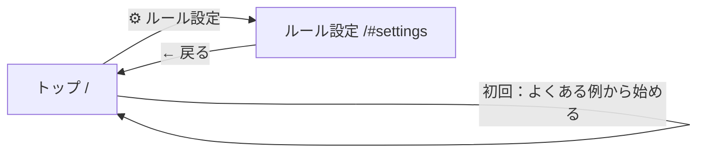

# T-05 情報設計（IA）：ゴミ出しカレンダー

## 設計方針（ユーザーのメンタルモデル）
- 毎朝の確認は「開いた瞬間に答えが出る」のが一番。**トップ画面＝今日・明日のゴミ**にして、操作なしで答えにたどり着けるようにする
- ルールの登録は最初の一度だけなので、トップから 1 タップで行ける「設定」画面に分ける
- ログインなし。データは端末のブラウザに保存する

## ① サイトマップ

```
トップ（/）……………………… 今日・明日のゴミ ＋ 2 週間の予定
└── ルール設定（/#settings）… ゴミの種類の追加・削除、よくある例から始める
```

- 階層は **2 層**
- 初回（ルールが 0 件）は、トップに「よくある例から始める」「自分で登録する」を出す

### 画面遷移


## ② ページ一覧表

| ページ名 | URL | 目的 | 主要機能 |
|---|---|---|---|
| トップ | `/` | 今日・明日に何を出すかを一目で知る | 今日・明日のゴミ（色・名前・出し方メモ）/ 収集なしの表示 / 2 週間の予定一覧 / 初回のはじめ方 |
| ルール設定 | `/#settings` | 住んでいる地域のルールを登録する | ゴミの種類の一覧 / 追加（名前・色・曜日・第何週・メモ）/ 削除 / よくある例で上書き |

## 評価観点のセルフチェック

| 観点 | 結果 |
|---|---|
| 階層が 3 層以内か | ○ 2 層 |
| 重要な機能に 2 クリック以内で行けるか | ○ いちばん大事な「今日のゴミ」は 0 クリック。ルール追加も 1 クリック |
| ナビゲーションに一貫性があるか | ○ トップ右上の「⚙ 設定」と、設定画面左上の「← 戻る」だけ。ハッシュで画面を持つので、ブラウザの戻るボタンも使える |
| メンタルモデルに沿っているか | ○ 「今日は何ゴミ？」に最短で答える。設定はたまにしか触らないので奥に置く |
